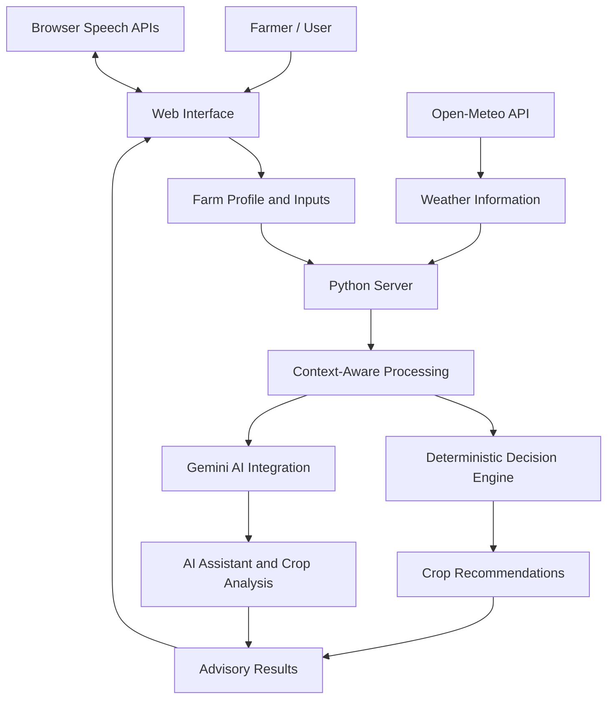

# FarmWise — Technical Design Document

## 1. Overview

FarmWise is a farmer-first AI agronomic decision-support platform designed to provide context-aware crop recommendations, crop-health analysis, weather information, and accessible agricultural guidance.

The system considers farmer-provided information and combines deterministic decision logic with AI-assisted features.

## 2. Technology Stack

| Component | Technology |
|---|---|
| Frontend | HTML, CSS, JavaScript |
| Backend | Python |
| AI Integration | Google Gemini API |
| Weather Information | Open-Meteo API |
| Voice Interaction | Browser Speech APIs |
| Testing | Project test suite |
| Version Control | Git and GitHub |

## 3. System Architecture

## 4. Core Components

### 4.1 Farmer Interface

The web interface collects farm information and provides access to crop advisory, AI assistance, weather information, crop scanning, and other platform features.

### 4.2 Python Backend

The Python server supports application functionality and relevant integrations. API requests and responses should be validated, and errors should be handled safely.

### 4.3 Deterministic Agronomic Decision Engine

The decision engine evaluates available farm information, including budget, water availability, rainfall probability, soil moisture, and pest-related risks where supported.

It generates candidate strategies, evaluates feasibility, and explains recommendations using the available inputs and rules.

### 4.4 AI Integration

The Google Gemini API supports conversational assistance and crop-image analysis. AI-generated information should be treated as advisory and validated against reliable agricultural sources wherever possible.

### 4.5 Weather Integration

The Open-Meteo API provides weather information used to support agricultural planning and weather-related alerts.

### 4.6 Voice and Language Accessibility

Browser speech-recognition and speech-synthesis capabilities support voice interaction and spoken responses in supported languages.

### 4.7 Additional Features

FarmWise also provides a What-If simulator, crop-health assistance, agricultural resources, and IoT monitoring features as implemented in the application.

## 5. Data Flow

1. The farmer enters farm details through the web interface.
2. The application processes the available inputs.
3. The decision engine evaluates crop suitability and feasibility.
4. External services provide relevant weather or AI-assisted information.
5. The application presents recommendations, explanations, and other available results.
6. The farmer can adjust inputs and compare alternative scenarios using the simulator.

## 6. Security Considerations

- Keep API keys out of source code and public repositories.
- Use environment variables or supported secure configuration methods.
- Validate user inputs and handle API errors.
- Avoid storing sensitive farmer information unnecessarily.
- Never commit real credentials or private personal data.

## 7. Testing Strategy

Testing should cover:

- Valid and missing farm inputs.
- Budget and water feasibility.
- Crop recommendation logic.
- Invalid API responses and network failures.
- AI integration errors.
- Weather-data handling.
- Voice and interface functionality.

Run the available automated tests using the commands documented in README.md.

## 8. Limitations

- Recommendations depend on the quality and completeness of the available inputs.
- AI-generated crop-health assessments may be inaccurate.
- Weather forecasts and external APIs may be unavailable or delayed.
- Prototype IoT functionality may use simulated readings rather than physical sensors.

## 9. Future Improvements

- Expand verified regional agricultural datasets.
- Improve automated testing and continuous integration.
- Strengthen API security and input validation.
- Integrate physical IoT sensors and validated sensor data.
- Improve multilingual accessibility and recommendation evaluation.
